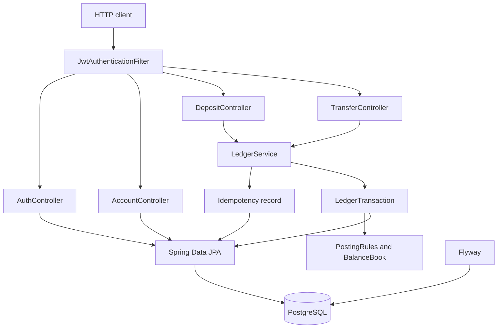

# Ledger API

A small double-entry digital wallet, published as a portfolio demo by [Arpan Bom](https://github.com/applycoding).

Deposits and transfers are accounting entries. The service does not capture cards, talk to a bank, hold customer funds, or move real money. It is not a licensed payments product and it is not production-hardened: one process, a demo JWT secret, no HSM, no KYC, and no reconciliation job.

## Features

- Customer accounts in any ISO 4217 currency with a minor-unit scale (`BigDecimal`, no floating point)
- Deposits and same-currency transfers posted as balanced journals
- Customer wallets are liabilities; a per-currency clearing account is the matching asset
- `Idempotency-Key` on deposits and transfers, scoped to the caller
- Optimistic locking (`@Version`) so concurrent debits cannot overdraw a balance
- Paginated transaction history with direction, amount, and balance after the posting
- JWT authentication (stateless), bean validation, and RFC 7807 problem responses
- OpenAPI UI via springdoc
- Flyway schema migrations, PostgreSQL at runtime, H2 in the PostgreSQL compatibility mode for tests

Spring Boot **3.5.16** is the last open-source 3.5 release. The project stays on Spring Boot 3, as a 3.x portfolio sample, rather than moving to Spring Boot 4.

## Architecture



A deposit debits the clearing account and credits the customer. A transfer debits the sender and credits the recipient. The journal is rejected unless debits and credits balance in each currency. Spendable balance is `credits - debits` on a customer account. `@Version` on the account row turns a lost update into HTTP 409.

Successful posts store the response under the caller's idempotency key. Repeating the same body returns that response and does not post again. The same key with a different body returns HTTP 409. A rejected request, such as insufficient funds, does not consume the key.

## Run

Requirements: Java 21 to build, Docker if you want PostgreSQL and the API together.

```bash
./mvnw test
docker compose up --build
```

The API listens on `http://localhost:8080`. Interactive docs are at `http://localhost:8080/swagger-ui.html`.

Set `LEDGER_JWT_SECRET` to at least 32 bytes outside this demo. The default in `application.yml` and Compose is a public sample value.

To point the process at your own Postgres:

```bash
export SPRING_DATASOURCE_URL=jdbc:postgresql://localhost:5432/ledger
export SPRING_DATASOURCE_USERNAME=ledger
export SPRING_DATASOURCE_PASSWORD=ledger
export LEDGER_JWT_SECRET=demo-only-secret-key-change-me-32b
./mvnw spring-boot:run
```

## API examples

Register and log in:

```bash
curl -s -X POST localhost:8080/api/v1/auth/register \
  -H 'content-type: application/json' \
  -d '{"email":"ada@example.com","password":"password123"}'

curl -s -X POST localhost:8080/api/v1/auth/login \
  -H 'content-type: application/json' \
  -d '{"email":"ada@example.com","password":"password123"}'
```

The login response carries `accessToken`. Send it as `Authorization: Bearer <token>`.

Open a USD account and deposit 100.00. `Idempotency-Key` is required and must be 8–200 characters:

```bash
curl -s -X POST localhost:8080/api/v1/accounts \
  -H "authorization: Bearer $TOKEN" \
  -H 'content-type: application/json' \
  -d '{"currency":"USD","name":"Everyday"}'

curl -s -X POST localhost:8080/api/v1/deposits \
  -H "authorization: Bearer $TOKEN" \
  -H 'content-type: application/json' \
  -H 'Idempotency-Key: 4f3c1a2e-7b90-4d1e-9c2a-demo0001' \
  -d '{"accountId":"ACCOUNT_ID","amount":"100.00","currency":"USD"}'
```

Transfer to another customer account in the same currency:

```bash
curl -s -X POST localhost:8080/api/v1/transfers \
  -H "authorization: Bearer $TOKEN" \
  -H 'content-type: application/json' \
  -H 'Idempotency-Key: 4f3c1a2e-7b90-4d1e-9c2a-demo0002' \
  -d '{"fromAccountId":"FROM_ID","toAccountId":"TO_ID","amount":"25.00","currency":"USD"}'
```

History:

```bash
curl -s "localhost:8080/api/v1/accounts/ACCOUNT_ID/transactions?page=0&size=20" \
  -H "authorization: Bearer $TOKEN"
```

| Status | When |
| --- | --- |
| 401 | Missing or invalid token, or bad login |
| 404 | Account is missing or belongs to someone else |
| 409 | Reused idempotency key with a different body, duplicate email, or a concurrent balance update |
| 422 | Currency does not match the account, or the balance would go negative |
| 400 | Validation, unknown currency, self-transfer, or a missing idempotency key |

Amounts that need more decimal places than the currency allows are rejected. `1.001` USD is invalid. `1500` JPY and `1.234` KWD are valid.

## Tests

```bash
./mvnw verify
```

JUnit 5 and Mockito cover money scale, posting rules, idempotency decisions, JWT issue/parse, and the ledger service replay path. `LedgerApiTest` boots the application on H2, runs the Flyway migration, and drives the HTTP API: auth, deposit, transfer, history, idempotency, ownership, and a two-thread overdraft race. JaCoCo writes `target/site/jacoco/index.html`.

GitHub Actions (`.github/workflows/ci.yml`) runs `./mvnw verify` and builds the image. The `Jenkinsfile` has Build, Test, Coverage, and Docker Build stages. The Jenkins agent needs JDK 21 and Docker; the Maven Wrapper supplies Maven.

## Project layout

```text
src/main/java/com/applycoding/ledger
  account     wallets owned by a user
  ledger      journals, posting rules, deposits, transfers, idempotency
  security    JWT issue and authentication filter
  user        register and login
src/main/resources/db/migration
  Flyway schema
```

## License

[MIT](LICENSE)
